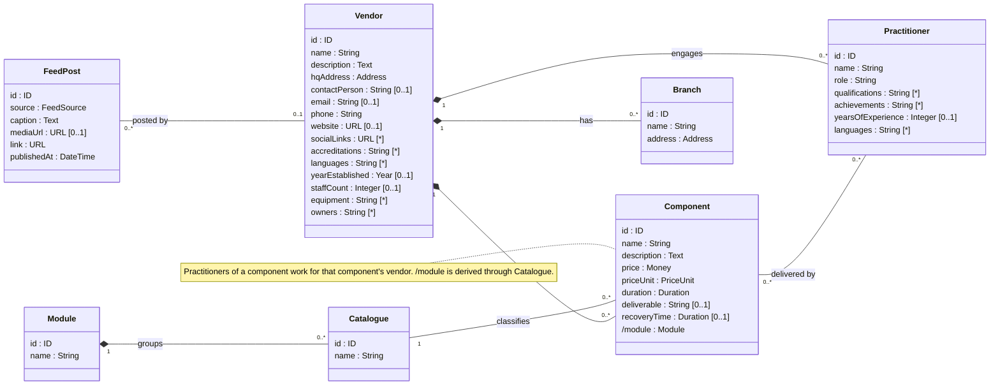

# Aalmaram Health — Class Diagram (v1, 15 Oct 2026)

Built from the 14 Oct product call and the 15 Oct class-diagram review with Nivedith
([transcript](inputs/2026-10-15-class-diagram-review-transcript.md), decisions and open questions in the
[product notebook §12](inputs/2026-10-14-product-notebook.md#12-update--class-diagram-review-2026-10-15)).
It replaces the draft reviewed in that meeting.

**Rendered diagram:** [`class-diagram.svg`](class-diagram.svg) (source of truth, with notes, types and notation key)
· [`class-diagram.png`](class-diagram.png) for sharing. The Mermaid below is the same model, split into the two
packages Nivedith asked for, for quick reading on GitHub.

- **A · What we offer** — master data kept by the team; built first.
- **B · The client's journey** — one client, many trips, one itinerary per trip.
- The two meet at `ItineraryItem`: a block that places one `Component`, optionally at one `Branch`.
- **MVP** (Nivedith, 15 Oct): all of A + `FeedPost`, and `Staff`, `Client`, `Conversation`, `Trip`,
  `TripRequirements`, `Itinerary`, `ItineraryItem`. `Payment`, `Booking`, `BookingEvent`, `HealthDossier` and
  `ClientPreference` follow.

## A · What we offer

## B · The client's journey

```mermaid
classDiagram
direction LR
class Staff {
  id : ID
  name : String
  email : String
  roles : StaffRole [1..*]
}
class Client {
  id : ID
  name : String
  dateOfBirth : Date [0..1]
  email : String
  phone : String
  address : Address [0..1]
  termsAcceptedAt : DateTime [0..1]
}
class ClientPreference {
  id : ID
  category : PreferenceCategory
  detail : Text
  source : String
  recordedAt : DateTime
}
class Conversation {
  id : ID
  channel : Channel
  occurredAt : DateTime
  transcript : Text
  summary : Text [0..1]
}
class Trip {
  id : ID
  name : String
  startDate : Date
  endDate : Date
  travellers : Integer
  status : TripStatus
}
class TripRequirements {
  id : ID
  summary : Text
  moduleMix : ModuleShare [*]
  budget : Money [0..1]
  pace : Pace [0..1]
  mustHaves : String [*]
  avoid : String [*]
}
class Itinerary {
  id : ID
  confirmedAt : DateTime [0..1]
  /totalPrice : Money
}
class ItineraryItem {
  id : ID
  startsAt : DateTime
  /endsAt : DateTime
  addedBy : AddedBy
  price : Money
}
class Booking {
  id : ID
  status : BookingStatus
  confirmedTime : DateTime [0..1]
  vendorReference : String [0..1]
  /vendor : Vendor
}
class BookingEvent {
  id : ID
  occurredAt : DateTime
  actor : Actor
  action : String
  detail : Text [0..1]
}
class Payment {
  id : ID
  amount : Money
  status : PaymentStatus
  method : String [0..1]
  paidAt : DateTime [0..1]
}
class HealthDossier {
  id : ID
  summary : Text
  documents : URL [*]
  sharedAt : DateTime [0..1]
}
class Component
class Branch
Staff "0..1" -- "0..*" Client : relationship manager of
Client "1" *-- "0..*" Trip : takes
Client "1" *-- "0..*" Conversation : has
Client "1" *-- "0..*" ClientPreference : builds up
Conversation "0..*" -- "0..1" Trip : about
Trip "1" *-- "0..1" TripRequirements : wants
Trip "1" *-- "1" Itinerary : plans
Trip "1" *-- "0..1" HealthDossier : results in
Itinerary "1" -- "0..*" Payment : paid by
Itinerary "1" *-- "0..*" ItineraryItem : made of
ItineraryItem "0..*" -- "1" Component : places
ItineraryItem "0..*" -- "0..1" Branch : at
ItineraryItem "1" *-- "0..1" Booking : booked through
Booking "1" *-- "0..*" BookingEvent : logs
note for Itinerary "Confirm, lock, pay, book. Confirming sets confirmedAt and freezes blocks and prices; later changes go through the relationship manager. Payment precedes any booking."
note for ItineraryItem "Health core = blocks with addedBy TEAM. A block's branch belongs to its component's vendor. Blocks fall within the trip's dates."
note for BookingEvent "Internal only. The client sees Booking.status, the green tick on the block."
```

`Component` and `Branch` in B are the classes from A.

## Types

| Type | Kind | Values / fields |
| --- | --- | --- |
| `Money` | datatype | `amount : Decimal`, `currency : CurrencyCode` |
| `Address` | datatype | `line`, `city`, `postcode`, `country` (all `String`) |
| `ModuleShare` | datatype | `module : Module`, `percent : 0..100` — percents in one `moduleMix` sum to 100 |
| `TripStatus` | enum | `PLANNING` → `AWAITING_PAYMENT` → `BOOKING` → `READY` → `IN_PROGRESS` → `COMPLETED`; `CANCELLED` |
| `BookingStatus` | enum | `PENDING`, `REQUESTED`, `CONFIRMED`, `DECLINED`, `CANCELLED` |
| `PaymentStatus` | enum | `PENDING`, `PAID`, `FAILED`, `REFUNDED` |
| `AddedBy` | enum | `TEAM` (health core), `CLIENT`, `AI` |
| `Channel` | enum | `AI_CHAT`, `STAFF_CHAT`, `CALL`, `EMAIL`, `WHATSAPP`, `IN_PERSON` |
| `Actor` | enum | `AI_AGENT`, `STAFF`, `VENDOR` |
| `PriceUnit` | enum | `PER_PERSON`, `FOR_TWO` (restaurants: Google's average for two), `PER_GROUP` |
| `Pace` | enum | `RELAXED`, `BALANCED`, `PACKED` |
| `PreferenceCategory` | enum | `DIET`, `ALLERGY`, `MOBILITY`, `LANGUAGE`, `LIKES`, `DISLIKES`, `OTHER` |
| `FeedSource` | enum | `VENDOR_INSTAGRAM`, `KERALA_TOURISM`, `NEWS` |
| `StaffRole` | enum | `ADMIN`, `RELATIONSHIP_MANAGER` |

## Modelling rules

- **Composition (◆)** = the part belongs to the whole and has no life outside it. Inventory (A) is never
  hard-deleted, only deactivated, so composition there means ownership, not cascade delete.
- **Associations carry no foreign-key attributes**; the links are the lines. `/name` marks a derived value
  (`Component./module`, `Itinerary./totalPrice`, `ItineraryItem./endsAt`, `Booking./vendor`).
- **`ItineraryItem` resolves the Itinerary↔Component many-to-many** as its own class, so the same component can
  appear twice (yoga on three mornings) and each block carries its own time, origin and price.
- **The AI agent is not a class.** It acts on the model: conversations → requirements and preferences, draft
  itineraries, per-slot suggestions, booking requests. Its runs are audited outside this domain model (`AiRun`).

## Relation to the current code (`prisma/schema.prisma`)

| Model today | In this diagram |
| --- | --- |
| `User` | `Staff` (+ `roles`) |
| `Vendor` (+ `accreditation` text) | `Vendor` (+ profile fields, `accreditations[]`), new `Branch`, `Practitioner` |
| `Module`, `Catalogue`, `Component` | Same; `Component` gains `duration`, `deliverable`, `recoveryTime`, `priceUnit` |
| `Client` (+ intake text fields, trip dates) | `Client` + `Trip` + `TripRequirements` + `ClientPreference` + `Conversation` |
| `Itinerary` (many per client, publish/approve statuses) | `Itinerary`, exactly one per `Trip`, locked by `confirmedAt` |
| `ItineraryItem` | `ItineraryItem` (+ `startsAt`, `addedBy`, frozen `price`, optional `Branch`) |
| `Report` (What-to-Expect) | Not a domain class: a document generated from the itinerary |
| `ChangeRequest` | Superseded: after confirm, changes go through the relationship manager |
| `ActivityLog` | Unchanged; audit infrastructure, outside this diagram |
| — | New: `Payment`, `Booking`, `BookingEvent`, `HealthDossier`, `FeedPost` |
